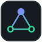
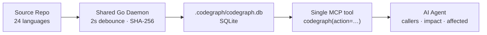

<div align="center">

<picture>
  <source media="(prefers-color-scheme: dark)" srcset="assets/logo-dark.svg">
  <source media="(prefers-color-scheme: light)" srcset="assets/logo-light.svg">
  
</picture>

# codegraph-go

**Give your AI coding agent a real call graph instead of blind `grep` — local Go MCP server indexing 24 languages &amp; 19 web frameworks in SQLite with instant impact analysis.**

[](https://go.dev)
[](#supported-languages)
[](#supported-languages)
[](https://modelcontextprotocol.io)

[Quick Start](#quick-start) · [Highlights](#highlights) · [Actions](#available-actions) · [Architecture](#architecture)

**English** · [简体中文](README.zh-CN.md)

</div>

## Architecture



**One call vs. ten greps.** Ask the agent *"who calls `ResolveAll` and what breaks if I change it?"*

```text
# ❌ Before: grep -rn "ResolveAll" → 30 hits → open 5 files → still guessing

# ✅ After: one tool call
codegraph(action="explore", query="ResolveAllContext", skipCode=false)
→ definition + signature + source
→ callers:  orchestrator.IndexAll, orchestrator.IndexAllWithProgress
→ callees:  resolver.resolveOneContext → matcher.MatchName

# Follow-up for blast radius
codegraph(action="impact", name="ResolveAllContext")
→ affected files ranked by reference count (2-hop BFS)
```

## Highlights

| | |
|---|---|
| 🕸️ **A real call graph, not blind `grep`** | `explore` / `callers` / `callees` / `impact` / `affected` / `communities` resolve upstream and downstream context in a single call |
| 🧰 **One tool, one schema** | 10+ graph, search and note capabilities routed through a single `codegraph(action=…)` tool — fewer schema tokens in every prompt |
| 🌐 **24 languages · 19 frameworks · 7 bridges** | Tree-sitter AST for 15 languages, Vue/Svelte/Astro SFC parsing, 6 regex fallbacks — plus cross-language edges through CGo, Python ctypes, React Native, Swift↔Objective-C and more |
| 🔄 **Shared daemon, 2-second sync** | One process per project owns `.codegraph/codegraph.db`; thin stdio proxies attach over a Unix socket, SHA-256 content hashing skips unchanged files, and a daemon whose worktree was deleted exits on its own |
| 🧠 **Cross-session memory for AI** | `store_fact` / `search_facts` pin findings, decisions and constraints to real symbols — facts survive full index rebuilds |
| 📦 **Single binary, zero services** | Embedded pure-Go SQLite — no external database, no daemon you have to babysit, works offline |

## Quick Start

### 1. Build

```bash
# Prerequisites: Go 1.25+, a C toolchain (tree-sitter needs CGO),
# and ripgrep (`rg`) on PATH
git clone https://github.com/dorokuma/codegraph-go.git
cd codegraph-go
CGO_ENABLED=1 go build -o codegraph-go ./cmd/codegraph-go

# Put it on PATH
cp codegraph-go ~/.local/bin/codegraph-go
```

### 2. Connect to your MCP client

**Claude Code / Cursor** — add to `.mcp.json` (project) or the client's MCP config:

```json
{
  "mcpServers": {
    "codegraph": {
      "command": "codegraph-go",
      "args": ["-workdir", "/path/to/your/project"]
    }
  }
}
```

**Codex** — add to `~/.codex/config.toml`:

```toml
[mcp_servers.codegraph]
command = "codegraph-go"
args = ["-workdir", "/path/to/your/project"]
```

> [!TIP]
> On first contact with a new repo the server creates `.codegraph/codegraph.db`, indexes the project, and a shared daemon keeps it incrementally in sync (2s debounce, SHA-256 gated). Nothing to configure.

## Available Actions

`codegraph` is a single tool; `action` routes to the capability. `projectPath` (any absolute path inside a project) selects the nearest `.codegraph/` index.

| Action | What it does |
|--------|--------------|
| `explore` | **Start here.** Symbol bag or plain query → definition + callers & callees in one budgeted reply; summary mode by default, `skipCode=false` adds source |
| `node` | `file` alone = numbered source + dependents; `name` = overload targets + resolution trail; `includeCode=true` returns bodies (bounded by overload count/budget) |
| `search` | Symbol FTS first, ripgrep literals after; `regex=true` for patterns, `no_ignore=true` to sweep ignored files |
| `files` | List files by glob — `rg --files` in normal projects, the indexed file list in home/broad mode |
| `callers` / `callees` | Walk the SQLite call graph one hop out; optional `file` pins overloads |
| `impact` | Multi-hop blast radius of a symbol — what breaks if it changes |
| `status` | Index health: counts, pending sync, rebuild state |
| `affected` | Tests impacted by a list of changed `files` |
| `communities` | Module-level community structure of the codebase |
| `store_fact` / `search_facts` | Attach / recall cross-session notes bound to symbols — survives index rebuilds |

## More Details

<a id="supported-languages"></a>
<details>
<summary><b>Supported Languages, Frameworks &amp; Bridges</b></summary>

**Languages (24)**

- **Tree-sitter AST (15):** Go, TypeScript, JavaScript, Python, C, C++, Java, Kotlin, Rust, Ruby, PHP, C#, Scala, Swift, Lua — with `qualified_name`, `signature`, `is_exported`, `visibility`, `return_type`
- **SFC parsers (3):** Vue, Svelte, Astro — file component + multi-script/frontmatter + opening-tag template refs
- **Regex fallback (6):** Dart, Luau, R, Objective-C, Liquid, Pascal — also the automatic fallback whenever tree-sitter fails on a file

**Web framework routes (19)**

Gin · chi · gorilla/mux · GoFrame · Express · NestJS · React Router · Flask · FastAPI · Django · Laravel · Rails · Spring · ASP.NET · Axum · actix · Rocket · Vapor · Play

Detected routes become `route` nodes named `METHOD /path`, linked to their handlers.

**Cross-language bridges (7)**

CGo (Go↔C) · Python ctypes · Python cffi · Python Cython · React Native/TurboModules · Expo · Swift↔Objective-C — plus synthesized edges for callbacks, EventEmitter, React render props, JSX children, C function pointers and GoFrame routes.

</details>

<details>
<summary><b>Configuration &amp; Exclude Rules</b></summary>

Optional YAML config — `-config` flag &gt; `$CODEGRAPH_CONFIG` &gt; `./codegraph-config.yaml` &gt; `~/.config/codegraph/config.yaml`:

```yaml
workdirs: [/path/to/project]   # authority roots for workdir validation
exclude_dirs:                  # extra dirs skipped while indexing & watching
  - "*-backup*"                #   bare name or glob on the dir basename
  - experiments/scratch        #   workdir-relative slash path
  - "./ref"                    #   anchored: only <workdir>/ref, not deeper
nice: 10                       # process nice level, clamped to [0,19]
max_procs: 4                   # GOMAXPROCS cap; explicit $GOMAXPROCS wins
index_workers: 3               # parallel extract workers
                               # ($CODEGRAPH_INDEX_WORKERS > this > min(8, cores-1))
cpu_quota_percent: 150         # run daemon under systemd CPUQuota (0 = off)
```

Env overrides: `CODEGRAPH_EXCLUDE_DIRS`, `CODEGRAPH_NICE`, `CODEGRAPH_MAX_PROCS`, `CODEGRAPH_CPU_QUOTA_PERCENT`, `CODEGRAPH_NO_DAEMON=1` (embedded mode), `CODEGRAPH_DAEMON_IDLE_TIMEOUT_MS` (default 300s).

**Exclude semantics, in human terms:**

- A rule without `/` matches directory *basenames* (`vendor`, `*-backup*`).
- A rule with `/` is workdir-relative; a `./` prefix anchors it to the root only.
- The indexer applies built-in skip rules (dependency caches, build outputs, the `.wt` worktree container) and does **not** read `.gitignore`; ripgrep-based tools do respect ignore files unless `no_ignore=true`.
- The same skip lists feed both indexer and `rg`, and each rule is translated between Go's `filepath.Match` and ripgrep's glob engine — edge cases (negated classes spanning `/`, reversed ranges, malformed patterns) are normalized so a bad rule can never abort a search.
- After upgrading `ripgrep`, re-verify the translation with `go test -p 2 ./internal/extraction ./internal/server -run TestRgExcludeArgsWeirdRulesAgreeWithWalker`.

**Daemon socket auth:** the daemon's Unix socket is always `chmod 0600`. Optionally set `CODEGRAPH_MCP_TOKEN` on both daemon and clients for constant-time token checks; unset means off.

</details>

<details>
<summary><b>Project Layout &amp; Local Development</b></summary>

```text
codegraph-go/
├── cmd/codegraph-go/        # Entry point only — no business logic
├── internal/
│   ├── extraction/          # Tree-sitter + regex extractors, SFC, frameworks,
│   │                        # bridges, index writer/orchestrator, indexer
│   │                        # skip rules + exclude-glob translation
│   ├── resolution/          # Parked refs → edges; path aliases, go.mod,
│   │                        # workspaces (pnpm/package/Cargo)
│   ├── db/                  # SQLite schema, queries, migration, WAL
│   ├── daemon/              # Shared daemon: spawn, lock, Unix-socket proxy,
│   │                        # systemd-run CPU quota, orphaned-worktree exit
│   ├── server/              # MCP server + single-tool action router;
│   │                        # ripgrep integration + rg-side exclude translation
│   ├── tools/               # explore / node / graph / affected / communities
│   ├── sync/                # File watcher with 2s debounce
│   ├── config/              # YAML config discovery & validation
│   ├── cgdir/               # .codegraph/ root discovery
│   └── safelog/             # Redaction-aware logging
├── integrations/pi/         # Pi-specific adapter (generic stdio server stays generic)
└── testdata/parity/         # Cross-language parity fixtures
```

**Gate:** `make check` is the single entry — `gofmt -l`, `go vet`, `go test -race`, `go build`, `staticcheck`. See [CONTRIBUTING.md](CONTRIBUTING.md).

**Flags:** `-workdir` (default `.`), `-config`, `-no-sync`, `-warm-daemon` (pre-warm the daemon via the normal client path and exit).

Extractor upgrades bump the index schema revision; the daemon detects the mismatch on first start after upgrade and rebuilds automatically — `status` reports the pending rebuild while it runs.

</details>

## Credits & License

Based on [colbymchenry/codegraph](https://github.com/colbymchenry/codegraph) — this Go port mirrors its 8-tool MCP surface behind a single `codegraph(action=…)` router and adds the `affected` extension, shared daemon, and fact storage.

MIT License.
