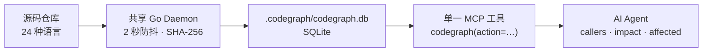

<div align="center">

<picture>
  <source media="(prefers-color-scheme: dark)" srcset="assets/logo-dark.svg">
  <source media="(prefers-color-scheme: light)" srcset="assets/logo-light.svg">
  
</picture>

# codegraph-go

**别让 AI 靠盲目 `grep` 猜代码结构——本地 Go MCP 代码图谱服务，秒建 24 种语言与 19 个 Web 框架调用链，一条请求查清上下游影响面。**

[](https://go.dev)
[](#supported-languages)
[](#supported-languages)
[](https://modelcontextprotocol.io)

[快速开始](#快速开始) · [核心特性](#核心特性) · [查询动作](#核心查询动作) · [架构](#架构)

[English](README.md) · **简体中文**

</div>

## 架构



**一次调用，胜过十次盲搜。** 直接问 Agent：「谁在调 `ResolveAll`？改它会炸什么？」

```text
# ❌ 以前：grep -rn "ResolveAll" → 30 条结果 → 翻 5 个文件 → 还在猜

# ✅ 现在：一次工具调用
codegraph(action="explore", query="ResolveAllContext", skipCode=false)
→ 定义 + 签名 + 源码
→ 调用方：orchestrator.IndexAll、orchestrator.IndexAllWithProgress
→ 被调方：resolver.resolveOneContext → matcher.MatchName

# 追问爆炸半径
codegraph(action="impact", name="ResolveAllContext")
→ 按关联次数排序的受影响文件（遍历 2 跳）
```

## 核心特性

| | |
|---|---|
| 🕸️ **真调用图，不是盲搜 `grep`** | `explore` / `callers` / `callees` / `impact` / `affected` / `communities` 一次调用查清上下游 |
| 🧰 **单工具路由，省 Schema Token** | 10+ 种图谱/全文/笔记能力聚合成一个 `codegraph(action=…)` 工具——每条提示词少背一堆 schema |
| 🌐 **24 种语言 · 19 个框架 · 7 种跨语言桥** | 15 种语言 Tree-sitter AST + Vue/Svelte/Astro SFC + 6 种正则兜底，打通 CGo、Python ctypes、React Native、Swift↔Objective-C 等跨语言边 |
| 🔄 **共享 Daemon，2 秒自动同步** | 每个项目一个进程独占 `.codegraph/codegraph.db`，瘦 stdio 代理经 Unix socket 接入；SHA-256 内容哈希跳过未变文件，worktree 被删后 daemon 自动退出 |
| 🧠 **AI 跨会话代码记忆** | `store_fact` / `search_facts` 把踩坑、决策、约束钉在具体符号上——重建索引也不丢 |
| 📦 **单二进制、内嵌纯 Go SQLite，零外部服务** | 开箱即用——没有要伺候的外部数据库，离线也能跑 |

## 快速开始

### 1. 构建

```bash
# 前置：Go 1.25+、C 编译器工具链（tree-sitter 需要 CGO），
# 且 PATH 上有 ripgrep（rg）
git clone https://github.com/dorokuma/codegraph-go.git
cd codegraph-go
CGO_ENABLED=1 go build -o codegraph-go ./cmd/codegraph-go

# 放进 PATH
cp codegraph-go ~/.local/bin/codegraph-go
```

### 2. 接入你的 MCP 客户端

**Claude Code / Cursor** —— 写入项目 `.mcp.json` 或客户端 MCP 配置：

```json
{
  "mcpServers": {
    "codegraph": {
      "command": "codegraph-go",
      "args": ["-workdir", "/path/to/your/project"]
    }
  }
}
```

**Codex** —— 写入 `~/.codex/config.toml`：

```toml
[mcp_servers.codegraph]
command = "codegraph-go"
args = ["-workdir", "/path/to/your/project"]
```

> [!TIP]
> 首次进入新仓库时，服务会自动创建 `.codegraph/codegraph.db` 并完成全量索引，随后由共享 Daemon 保持增量同步（2 秒防抖 + SHA-256 门控）。无需任何配置。

## 核心查询动作

`codegraph` 是单一工具，`action` 参数路由到具体能力；`projectPath`（项目内任意绝对路径）自动定位最近的 `.codegraph/` 索引。

| 动作 | 用途 |
|------|------|
| `explore` | **首选入口。** 符号集合或普通查询 → 一次返回定义与调用方/被调方（带预算控制）；默认摘要模式，`skipCode=false` 才带源码 |
| `node` | 只传 `file` = 带行号源码 + 依赖方；传 `name` = 重载目标 + 解析轨迹；`includeCode=true` 返回代码体（受重载数/预算限制） |
| `search` | 先查符号 FTS，再走 ripgrep 字面量；`regex=true` 用正则，`no_ignore=true` 扫忽略文件 |
| `files` | 按 glob 列出文件——普通项目走 `rg --files`，home/broad 模式查索引文件表 |
| `callers` / `callees` | 沿 SQLite 调用图走一跳；`file` 可钉住重载 |
| `impact` | 多跳爆炸半径——改了这个符号会牵连什么 |
| `status` | 索引健康：计数、待同步、重建状态 |
| `affected` | 给一组改动的 `files`，查出受影响的测试 |
| `communities` | 代码库的模块级社区结构 |
| `store_fact` / `search_facts` | 把跨会话笔记绑定到符号上存取——重建索引不丢 |

## 进阶配置与架构详情

<a id="supported-languages"></a>
<details>
<summary><b>支持的语言、框架与跨语言桥接</b></summary>

**语言（24 种）**

- **Tree-sitter AST（15 种）：** Go、TypeScript、JavaScript、Python、C、C++、Java、Kotlin、Rust、Ruby、PHP、C#、Scala、Swift、Lua——带 `qualified_name`、`signature`、`is_exported`、`visibility`、`return_type`
- **SFC 解析（3 种）：** Vue、Svelte、Astro——文件组件 + 多 script/frontmatter + 开标签模板引用
- **正则兜底（6 种）：** Dart、Luau、R、Objective-C、Liquid、Pascal——同时也是 tree-sitter 解析失败时的自动回退

**Web 框架路由（19 个）**

Gin · chi · gorilla/mux · GoFrame · Express · NestJS · React Router · Flask · FastAPI · Django · Laravel · Rails · Spring · ASP.NET · Axum · actix · Rocket · Vapor · Play

检测到的路由存为 `route` 节点，命名为 `METHOD /path`，并挂到对应 handler。

**跨语言桥接（7 种）**

CGo（Go↔C）· Python ctypes · Python cffi · Python Cython · React Native/TurboModules · Expo · Swift↔Objective-C——另合成回调、EventEmitter、React render props、JSX 子组件、C 函数指针与 GoFrame 路由等动态分发边。

</details>

<details>
<summary><b>配置与目录排除规则</b></summary>

可选 YAML 配置——`-config` 参数 &gt; `$CODEGRAPH_CONFIG` &gt; `./codegraph-config.yaml` &gt; `~/.config/codegraph/config.yaml`：

```yaml
workdirs: [/path/to/project]   # workdir 校验的授权根
exclude_dirs:                  # 索引与监听时额外跳过的目录
  - "*-backup*"                #   裸名或对目录 basename 的 glob
  - experiments/scratch        #   相对 workdir 的斜杠路径
  - "./ref"                    #   锚定：只排 <workdir>/ref，不含更深层
nice: 10                       # 进程 nice 值，夹取到 [0,19]
max_procs: 4                   # GOMAXPROCS 上限；显式 $GOMAXPROCS 优先
index_workers: 3               # 并行抽取 worker 数
                               # ($CODEGRAPH_INDEX_WORKERS > 此项 > min(8, cores-1))
cpu_quota_percent: 150         # 在 systemd CPUQuota 下运行 daemon（0 = 关）
```

环境变量覆盖：`CODEGRAPH_EXCLUDE_DIRS`、`CODEGRAPH_NICE`、`CODEGRAPH_MAX_PROCS`、`CODEGRAPH_CPU_QUOTA_PERCENT`、`CODEGRAPH_NO_DAEMON=1`（内嵌模式）、`CODEGRAPH_DAEMON_IDLE_TIMEOUT_MS`（默认 300 秒）。

**排除规则的人话解释：**

- 不带 `/` 的规则匹配目录 *basename*（如 `vendor`、`*-backup*`）。
- 带 `/` 的规则相对 workdir；`./` 前缀表示只锚定根目录。
- 索引器使用内置跳过表（依赖缓存、构建产物、`.wt` worktree 容器），**不读** `.gitignore`；ripgrep 系工具则遵守 ignore 文件，除非传 `no_ignore=true`。
- 索引器与 `rg` 共用同一份跳过表，每条规则在 Go `filepath.Match` 与 ripgrep glob 引擎间做翻译——跨 `/` 的否定类、倒置区间、畸形模式等边角都会被规范化，一条坏规则永远不会让搜索崩掉。
- 升级本机 `ripgrep` 后，用 `go test -p 2 ./internal/extraction ./internal/server -run TestRgExcludeArgsWeirdRulesAgreeWithWalker` 复验翻译一致性。

**Daemon socket 鉴权：** daemon 的 Unix socket 恒为 `chmod 0600`；如需第二道防线，在 daemon 与客户端同时设置 `CODEGRAPH_MCP_TOKEN`（常数时间比较，不落日志），不设置即关闭。

</details>

<details>
<summary><b>目录结构与本地开发</b></summary>

```text
codegraph-go/
├── cmd/codegraph-go/        # 仅入口——不堆业务逻辑
├── internal/
│   ├── extraction/          # Tree-sitter + 正则抽取、SFC、框架路由、
│   │                        # 跨语言桥、索引写入/编排、索引器跳过规则
│   │                        # 与排除 glob 翻译
│   ├── resolution/          # 暂存引用 → 边；路径别名、go.mod、
│   │                        # workspace（pnpm/package/Cargo）
│   ├── db/                  # SQLite schema、查询、迁移、WAL
│   ├── daemon/              # 共享 daemon：spawn、锁、Unix socket 代理、
│   │                        # systemd-run CPU 配额、孤儿 worktree 自动退出
│   ├── server/              # MCP 服务 + 单工具 action 路由；
│   │                        # ripgrep 集成 + rg 侧排除规则翻译
│   ├── tools/               # explore / node / graph / affected / communities
│   ├── sync/                # 2 秒防抖文件监听
│   ├── search/              # 标识符分词 + 模糊评分/编辑距离辅助函数
│   ├── config/              # YAML 配置发现与校验
│   ├── cgdir/               # .codegraph/ 根定位
│   └── safelog/             # 带脱敏的日志
├── integrations/pi/         # Pi 专用适配层（通用 stdio 服务保持通用）
└── testdata/parity/         # 跨语言对齐 fixture
```

**门禁：** `make check` 是唯一入口——`gofmt -l`、`go vet`、`go test -race`、`go build`、`staticcheck`。详见 [CONTRIBUTING.md](CONTRIBUTING.md)。

**启动参数：** `-workdir`（默认 `.`）、`-config`、`-no-sync`、`-warm-daemon`（经正常客户端路径预热 daemon 后退出）。

抽取逻辑升级会抬高索引 schema 版本；daemon 升级后首次启动检测到版本不一致会自动全量重建——重建期间 `status` 会报告 pending 状态。

</details>

## 致谢与协议

基于 [colbymchenry/codegraph](https://github.com/colbymchenry/codegraph) —— 本 Go 移植将其 8 个 MCP 工具统一到单一 `codegraph(action=…)` 路由之后，并新增 `affected` 扩展、共享 daemon 与事实存储。

MIT License.
